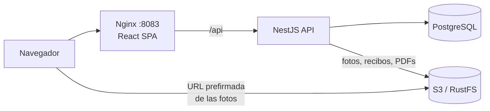

# Yamesi

[](https://github.com/vzuliani97/yamesi/actions/workflows/ci.yml)

Sistema contable y de inventario para una joyería: lotes de oro, piezas con foto, facturación con PDF, caja menor con recibos y cierre de caja diario. Es una reconstrucción original, con **datos ficticios**, de un sistema que construí y mantengo para un negocio real, que reemplazó el manejo en Excel y los recibos de caja menor en papel.

*English: accounting and inventory system for a jewelry store. NestJS + TypeScript + PostgreSQL + React, with S3 storage (RustFS locally) for piece photos, receipts and invoice PDFs. Gold traceability from supplier lot to sold piece, gap-free invoice numbering under concurrency, a daily cash closing that locks the day, margin reports from cost frozen at sale time, and a full audit log. 23 automated tests, including one against a real S3-compatible server.*

## Qué resuelve

| Necesidad del negocio | Cómo lo resuelve |
|---|---|
| Saber de qué compra de oro salió cada pieza | Cada pieza consume gramos de un **lote** (proveedor, kilates, costo por gramo). El lote nunca queda en negativo. |
| Numeración de facturas consecutiva y sin huecos | Un contador que se incrementa **dentro de la transacción** de la factura. Las `SEQUENCE` de PostgreSQL dejan huecos al hacer rollback. |
| Una pieza no se puede vender dos veces | Bloqueo de las filas en orden y `UNIQUE (piece_id)` en `invoice_items` como última defensa |
| Reemplazar los recibos de caja menor en papel | Gastos con categoría y **foto del recibo** en S3 |
| Cuadrar la caja al final del día | Efectivo esperado = base + ventas en efectivo − gastos. Al cerrar se registra la diferencia y **el día queda bloqueado**. |
| Conocer el margen real | El costo de cada pieza (oro al precio de su lote + mano de obra) queda **congelado al vender**. |
| Saber quién hizo qué | Registro de auditoría escrito en la misma transacción que el cambio |

## Stack

- **Backend:** NestJS 11, TypeScript, PostgreSQL 16 (SQL explícito y migraciones versionadas), Zod, JWT, bcrypt, Helmet, PDFKit, AWS SDK v3 (S3)
- **Almacenamiento de archivos:** S3 en AWS y RustFS (compatible con S3) en local
- **Frontend:** React 19, TypeScript, Vite, servido con Nginx sin privilegios
- **Pruebas:** Jest y Supertest (4 unitarias, 17 de integración contra PostgreSQL y 2 contra un servidor S3 real)
- **Infraestructura:** Docker multi-stage, Docker Compose, GitHub Actions

## Arquitectura



Las fotos se muestran con **URLs prefirmadas** que vencen en 5 minutos: el navegador las descarga directamente del almacenamiento sin pasar por la API y sin credenciales. Los PDF de factura, en cambio, se sirven a través de la API para exigir sesión.

## Decisiones técnicas

**Sin decimales flotantes.** El dinero se guarda en pesos enteros y el oro en **miligramos enteros**. `0.1 + 0.2` gramos se guarda como exactamente 300 mg.

**Numeración sin huecos y bajo concurrencia.**
```sql
UPDATE invoice_counter SET last_number = last_number + 1 RETURNING last_number
```
La fila del contador queda bloqueada hasta el COMMIT, así que las facturas simultáneas se ordenan. Si la venta falla, el rollback deshace el incremento. Probado con 8 facturas simultáneas (números 1 a 8, sin repetidos ni huecos) y con una venta fallida seguida de otra (la segunda recibe el número siguiente).

**Venta todo o nada.** Las piezas se bloquean con `SELECT ... ORDER BY id FOR UPDATE`, siempre en el mismo orden para evitar *deadlocks*. Luego se marcan como vendidas solo si todas siguen disponibles. Si una ya se vendió, se revierte toda la factura y la respuesta indica cuáles no estaban disponibles.

**El cierre de caja bloquea el día.** Las ventas y los gastos toman un *advisory lock* **compartido** sobre su fecha, y el cierre toma uno **exclusivo**. El cierre espera a que terminen las ventas en curso y ninguna venta nueva puede colarse mientras se calcula. Después del cierre, cualquier venta o gasto de esa fecha recibe `DAY_CLOSED`.

**La fecha es la de Bogotá, no la de UTC.** A las 8 p. m. en Colombia ya es el día siguiente en UTC. La fecha de negocio se calcula con la zona horaria configurada (`BUSINESS_TIMEZONE`).

**Archivos seguros.** El tipo de imagen se verifica por sus primeros bytes (*magic numbers*), no por el nombre ni por el `Content-Type`, que el cliente puede falsificar. Hay un límite de 2 MB, en Multer y en Nginx.

**PDF fuera de la transacción.** La factura se confirma primero y el PDF se genera después. Si la generación falla, la venta sigue siendo válida y el PDF se regenera al descargarlo.

**Idempotencia.** `Idempotency-Key` obligatoria al facturar: un reintento devuelve la misma factura, y una llave reutilizada con datos distintos responde 409.

## Ejecutar

```bash
cp .env.example .env      # y cambia los valores
make up                   # o: docker compose up --build
```

- Aplicación: http://localhost:8083
- Usuarios demo: `admin@yamesi.local` y `vendedor@yamesi.local`, con la contraseña de `DEMO_PASSWORD`
- Los datos demo (2 lotes y 6 piezas) son ficticios y solo se cargan en una base de datos vacía.

## Pruebas

```bash
make test                 # todo en contenedores: PostgreSQL y RustFS desechables
```

Escenarios cubiertos, entre otros:

- 8 facturas simultáneas reciben los números 1 a 8.
- Dos ventas simultáneas de la misma pieza: una se aprueba y la otra recibe `PIECE_NOT_AVAILABLE`.
- Una venta rechazada no consume número de factura.
- El costo queda congelado: cambiar después el precio del lote no altera el margen de ventas pasadas.
- Efectivo esperado = base + efectivo − gastos; las ventas con tarjeta no cuentan.
- Después del cierre se rechazan ventas, gastos y un segundo cierre.
- Un archivo disfrazado de PNG se rechaza y no consume oro.
- Contra RustFS real: lectura y escritura binaria, URL prefirmada válida sin credenciales y firma alterada rechazada con 403.

## API

| Método | Ruta | Acceso |
|---|---|---|
| POST | `/api/auth/login` | Público |
| GET, POST | `/api/lots` | Lectura: todos. Creación: admin |
| GET, POST | `/api/pieces` (multipart con `image`) | Lectura: todos. Creación: admin |
| POST | `/api/invoices` (`Idempotency-Key`) | Admin y vendedor |
| GET | `/api/invoices`, `/api/invoices/:id`, `/api/invoices/:id/pdf` | Admin y vendedor |
| GET, POST | `/api/expenses` (multipart con `receipt`) | Admin y vendedor |
| GET | `/api/closings/today`, `/api/closings/:date` | Admin y vendedor |
| POST | `/api/closings` | Admin |
| GET | `/api/reports/gold-inventory`, `/api/reports/margins?from&to` | Admin |
| GET | `/api/audit` | Admin |

## Siguientes pasos

- Facturación electrónica ante la DIAN mediante un proveedor tecnológico. Este PDF **no** es una factura electrónica.
- Regla de ciclo de vida en el bucket para borrar archivos huérfanos (fotos subidas cuyo registro falló).
- Inventario por sede y transferencias entre sedes.
- Reapertura de un día cerrado con autorización y registro en auditoría.
