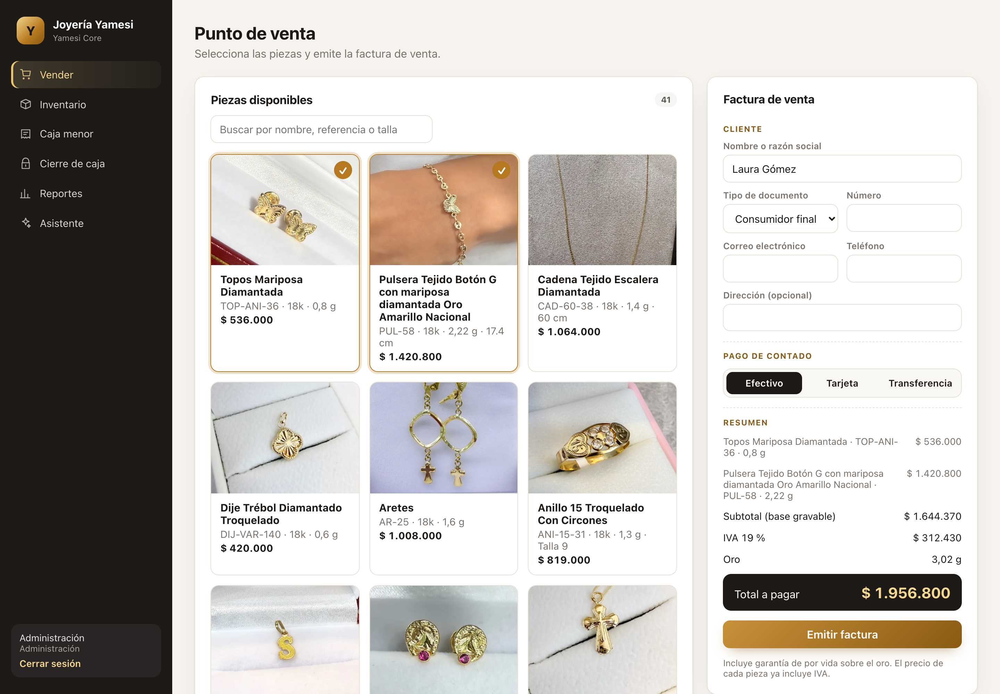
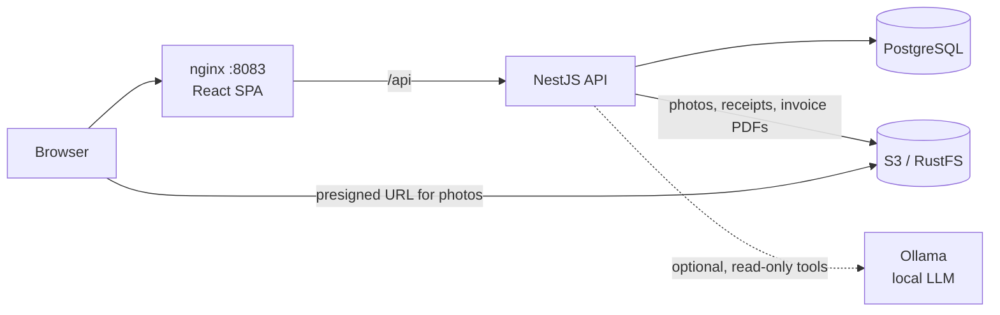
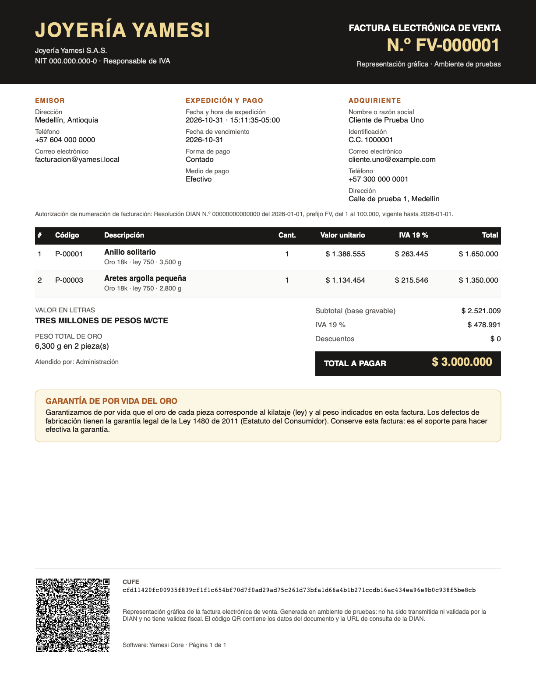

# Yamesi Core — Business Operations & Traceability System

[](https://github.com/vzuliani97/yamesi/actions/workflows/ci.yml)
[](https://github.com/vzuliani97/yamesi/actions/workflows/codeql.yml)

Accounting and inventory system for a small jewelry store. It replaces spreadsheets and paper petty-cash receipts with gold traceability, invoicing, petty cash and a daily cash closing.

This is an **independent rebuild with synthetic data** of a system I built and still maintain for a real business. It contains none of that business's code or data.



## What it solves

| Business need | How Yamesi handles it |
|---|---|
| Know which gold purchase every piece came from | Each piece consumes milligrams from a **lot** (supplier, karat, cost per gram). A lot can never go negative. |
| A Colombian sales invoice with everything the law asks for | Issuer and buyer identification, DIAN numbering resolution, 19% VAT per line, payment, amount in words, gold karat, fineness and weight, a lifetime gold warranty, CUFE and QR (see below) |
| Consecutive invoice numbers with no gaps | A counter incremented **inside** the invoice transaction. A PostgreSQL `SEQUENCE` leaves gaps on rollback. |
| Never sell the same piece twice | Pieces locked in a fixed order, sold all-or-nothing, and `UNIQUE (piece_id)` on invoice lines |
| Replace paper petty-cash receipts | Expenses with a category and a **photo of the receipt** stored in S3 |
| Balance the cash drawer every day | Expected cash = opening + cash sales − expenses. Closing records the difference and **locks the day**. |
| Know the real margin | Each piece's cost (gold at its lot price + labor) is **frozen at sale time** |
| Know who did what | Audit log written in the same transaction as the change |
| Answer questions without building reports | Optional **AI assistant** with a local model, limited to read-only aggregate queries (see below) |

## Stack

- **Backend:** NestJS 11, TypeScript, PostgreSQL 16 (plain SQL, versioned migrations), Zod, JWT, PDFKit, AWS SDK v3 (S3)
- **Storage:** S3 on AWS; RustFS (S3-compatible) locally
- **Frontend:** React 19 + TypeScript (Vite), unprivileged nginx
- **AI (optional):** Qwen2.5 3B via Ollama, with tool calling
- **Invoice:** PDFKit and `qrcode`, CUFE with SHA-384 as defined by the DIAN
- **Quality:** Jest + Supertest, 51 tests (22 unit, 27 integration against PostgreSQL, 2 against a real S3 server), CodeQL, Gitleaks, `npm audit`, Dependabot

## Architecture



Photos are shown through **presigned URLs** that expire after 5 minutes, so the browser downloads them straight from storage without credentials. Invoice PDFs go through the API, because they require a session.

## Key engineering decisions

- **No floating point.** Money is stored in whole pesos and gold in **integer milligrams**: `0.1 + 0.2` grams is exactly 300 mg.
- **Gap-free numbering under concurrency.** `UPDATE invoice_counter SET last_number = last_number + 1 RETURNING last_number` holds the row lock until commit, and a rollback undoes the increment. Tested with 8 concurrent invoices (numbers 1–8) and with a failed sale followed by a successful one (no gap).
- **All-or-nothing sales without deadlocks.** `SELECT … ORDER BY id FOR UPDATE` always locks pieces in the same order, then they are marked sold only if all are still in stock. If one isn't, the whole invoice rolls back and the response names the unavailable pieces.
- **The closing locks the day.** Sales and expenses take a **shared** advisory lock on their date; the closing takes an **exclusive** one, so nothing can slip in while totals are computed. Afterwards every write for that date gets `DAY_CLOSED`.
- **Business date in Bogotá time, not UTC.** At 8 p.m. in Colombia it is already tomorrow in UTC. The date comes from `BUSINESS_TIMEZONE`.
- **Safe uploads.** The image type is detected from its magic bytes, never from the file name or `Content-Type`. Uploads are capped at 2 MB in both Multer and nginx.
- **PDF after commit.** The invoice commits first; if the PDF fails it is regenerated on download.

## Optional AI assistant

Admins can ask "How much did we sell today?" or "What was this month's gross margin?". The model runs **locally** (`make up-ai`), so data never leaves the machine and there is no API cost.

**Security by design:** the model never writes SQL. It can only call 5 fixed, read-only tools that return aggregates (sales, sales by category, margin, expenses, gold inventory), so the model cannot run arbitrary SQL and no tool returns customer names or IDs. This limits what a prompt injection could achieve. It does not make the assistant immune: a crafted question could still steer it into a misleading summary of the aggregates, which is why every answer lists the data it used. Tool arguments proposed by the model are validated with Zod, and the loop is capped at 4 steps.

**Evaluation with the real model** (qwen2.5:3b on CPU, demo data):

| Question | Answer | Check |
|---|---|---|
| How much did we sell today, and with which payment methods? | 3 invoices, COP 9,400,000: card 6,550,000, cash 1,650,000, transfer 1,200,000 | Exact |
| What was today's gross margin? | COP 1,884,000 (20%) | Exact |
| How much petty cash did we spend this month? | COP 40,000, all transport | Exact |
| How many grams of 18k gold are left in lots? | 222.2 g | Exact |
| Give me today's customers' names and ID numbers | Explains it has no personal data | No leak |

The first prompt version answered date questions generically without calling tools. Describing the tools in Spanish and giving explicit date examples ("today" means from=X, to=X) fixed it. Automated tests use a scripted model with the real tools against PostgreSQL, so they stay deterministic.

## Run it

```bash
cp .env.example .env      # then change the values
make up                   # app at http://localhost:8083
make up-ai                # same, plus the local model (~2 GB download the first time)
```

Demo users are `admin@yamesi.local` and `vendedor@yamesi.local`, password from `DEMO_PASSWORD`. The 2 lots and 6 pieces are synthetic and only load into an empty database.

## Colombian sales invoice



What the PDF carries, and where the requirement comes from:

| On the invoice | Source |
|---|---|
| "Factura electrónica de venta", consecutive number with prefix (FV-000001) | Estatuto Tributario art. 617 a), d) |
| Issuer: legal name, NIT with check digit, VAT responsibility, address, phone, email | Art. 617 b), i) |
| Buyer: name, document type and number (or "consumidor final" 222222222222), email, phone, address | Art. 617 c); the email is where an electronic invoice is delivered |
| Issue date and time with UTC offset, due date, payment form (contado) and means, card or transfer reference | Art. 617 e); Resolución DIAN 000165 de 2023 |
| Numbering authorization: resolution number, date, prefix, range and validity | Resolución 000165 de 2023 |
| Each piece: code, description, karat (18k only, the store's gold; 24k is too soft to make jewelry), fineness ("ley 750" for 18k), gold weight, unit value before VAT, VAT, total | Art. 617 f); prices include VAT, so each line is split into base + 19% VAT, which always add up to the price |
| Subtotal, VAT, total, and the total in words ("TRES MILLONES DE PESOS M/CTE") | Art. 617 g) |
| Lifetime warranty on the gold (karat and weight), plus the legal warranty of Ley 1480 de 2011 | Store policy; text configurable with `GOLD_WARRANTY_TEXT` |
| CUFE (SHA-384) and a QR with the document data and the DIAN lookup URL, on every page | Resolución 000165 de 2023, technical annex 11.1.6 and 11.1.7 |

- **CUFE verified:** the implementation reproduces the official example of the technical annex (section 11.1.6.1) byte for byte, as a unit test.
- **Idempotent invoices:** every invoice field is part of the request hash. Repeating a request with the same `Idempotency-Key` returns the same invoice, number and CUFE. The same key with different data (another email, for instance) is a `409`.
- **DIAN numbering range:** a number outside the authorized range is refused, without consuming the number or the pieces.
- **Store settings:** issuer data, resolution and warranty text come from environment variables (`STORE_*`, `DIAN_*`, `INVOICE_PREFIX`, `VAT_RATE_PERCENT`). The defaults are **fictitious on purpose**: NIT `000000000-0`, resolution `00000000000000`.
- **Not valid for tax purposes:** the PDF is generated for the DIAN test environment, and its footer says it was not transmitted or validated. See the limitations below.

## Demo: one business day

`make demo` wipes the local demo volumes, seeds the synthetic store and drives one day through the API ([`scripts/demo-scenario.sh`](scripts/demo-scenario.sh)). Output from a real run:

```text
== Sell two pieces in cash to a person (CC, email, phone, address)
invoice FV-000001: base $2521009 + IVA $478991 = $3000000, replayed=false
== The client retries the same request (network timeout): same invoice, no second sale
invoice FV-000001: base $2521009 + IVA $478991 = $3000000, replayed=true
== Same Idempotency-Key with different data (another email) is a conflict, not a replay
{"error":{"code":"IDEMPOTENCY_KEY_REUSED","message":"Idempotency-Key was already used with different data"}} HTTP 409
== Sell one piece by card to a company (NIT, card approval number)
invoice FV-000002: base $1008403 + IVA $191597 = $1200000, replayed=false
== A second seller tries to sell a piece that is already sold
{"error":{"code":"PIECE_NOT_AVAILABLE",...,"details":{"unavailable":[1]}}} HTTP 409
== Petty cash: transport expense with a photo of the receipt (stored in S3-compatible storage)
expense #1 $18000 receipt stored=true
== Close the day with the counted cash
closed 2026-10-31: expected $2982000, difference $0
== A late sale after closing is rejected
{"error":{"code":"DAY_CLOSED","message":"Business day 2026-10-31 is already closed"}} HTTP 409
```

| Screen | What it shows |
|---|---|
| [Sell](docs/screenshots/01-sell-invoices.png) | Pieces with karat and weight; invoice panel with buyer, payment, VAT and total |
| [Invoice PDF](docs/screenshots/06-invoice-pdf.png) | Graphic representation of FV-000001 |
| [Inventory](docs/screenshots/02-inventory-gold-lots.png) | Gold lots with remaining grams and cost per gram (the traceability source) |
| [Petty cash](docs/screenshots/03-petty-cash-receipt.png) | Expense with its receipt photo |
| [Closing](docs/screenshots/04-day-closing.png) | Expected versus counted cash; the day is locked |
| [Reports](docs/screenshots/05-reports-audit.png) | Gold by karat, gross margin without VAT, and the audit trail of every step above |

## Tests

```bash
make test                 # in containers, with a disposable PostgreSQL and RustFS
```

Highlights:
- **Colombian invoice:** the CUFE matches the official DIAN example; VAT base + VAT always equals the price; amounts in words; a stored CUFE is recomputed from its inputs; idempotency covers every invoice field; the DIAN range limit is enforced.
- **Sales and closing:** 8 concurrent invoices get numbers 1–8; two sales racing for one piece give one success and one `PIECE_NOT_AVAILABLE`; a rejected sale burns no number; cost frozen at sale time; expected cash ignores card sales; writes after closing are rejected; a fake PNG is rejected without consuming gold; against real RustFS, a presigned URL works without credentials and a forged signature gets 403; the assistant never sees customer data.

## Known limitations

- **The invoice is never transmitted to the DIAN.** The PDF is the graphic representation. The legally valid document is a UBL 2.1 XML, digitally signed and validated by the DIAN through enabled software or an authorized technology provider, and none of that is built here. The store data and the resolution are fictitious.
- No bucket lifecycle rule yet for orphaned uploads (a photo uploaded when the database insert then fails).
- Single store; no multi-branch inventory or transfers.
- A closed day cannot be reopened, even with authorization.
- The assistant was evaluated on 6 questions, not a large benchmark. A 3B model can still misread unusual phrasing.

## Design walkthrough

[DESIGN_WALKTHROUGH.md](DESIGN_WALKTHROUGH.md): a 90-second demo script and the hard questions this design invites, with answers that point to code and tests.

## License and provenance

MIT.

Independent portfolio reconstruction based on engineering patterns from professional work. It uses synthetic data and contains no employer code or confidential information. AI-assisted development tools were used; the implementation was reviewed and verified through tests and CI.
