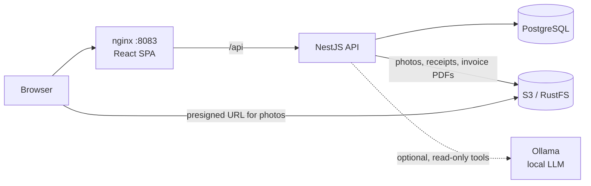

# Yamesi

[](https://github.com/vzuliani97/yamesi/actions/workflows/ci.yml)
[](https://github.com/vzuliani97/yamesi/actions/workflows/codeql.yml)

Accounting and inventory system for a small jewelry store. It replaces spreadsheets and paper petty-cash receipts with gold traceability, invoicing, petty cash and a daily cash closing.

This is an **independent rebuild with synthetic data** of a system I built and still maintain for a real business. It contains none of that business's code or data.

## What it solves

| Business need | How Yamesi handles it |
|---|---|
| Know which gold purchase every piece came from | Each piece consumes milligrams from a **lot** (supplier, karat, cost per gram). A lot can never go negative. |
| Consecutive invoice numbers with no gaps | A counter incremented **inside** the invoice transaction. A PostgreSQL `SEQUENCE` leaves gaps on rollback. |
| Never sell the same piece twice | Pieces locked in a fixed order, sold all-or-nothing, and `UNIQUE (piece_id)` on invoice lines |
| Replace paper petty-cash receipts | Expenses with a category and a **photo of the receipt** stored in S3 |
| Balance the cash drawer every day | Expected cash = opening + cash sales − expenses. Closing records the difference and **locks the day**. |
| Know the real margin | Each piece's cost (gold at its lot price + labor) is **frozen at sale time** |
| Know who did what | Audit log written in the same transaction as the change |
| Answer questions without building reports | Optional **AI assistant** with a local model, limited to read-only aggregate queries (see below) |

## Stack

- **Backend:** NestJS 11, TypeScript, PostgreSQL 16 (plain SQL, versioned migrations), Zod, JWT, PDFKit, AWS SDK v3 (S3)
- **Storage:** S3 on AWS; RustFS (S3-compatible) locally
- **Frontend:** React 19 + TypeScript (Vite), unprivileged nginx
- **AI (optional):** Qwen2.5 3B via Ollama, with tool calling
- **Quality:** Jest + Supertest, 32 tests (9 unit, 21 integration against PostgreSQL, 2 against a real S3 server), CodeQL, Gitleaks, `npm audit`, Dependabot

## Architecture



Photos are shown through **presigned URLs** that expire after 5 minutes, so the browser downloads them straight from storage without credentials. Invoice PDFs go through the API, because they require a session.

## Key engineering decisions

- **No floating point.** Money is stored in whole pesos and gold in **integer milligrams**: `0.1 + 0.2` grams is exactly 300 mg.
- **Gap-free numbering under concurrency.** `UPDATE invoice_counter SET last_number = last_number + 1 RETURNING last_number` holds the row lock until commit, and a rollback undoes the increment. Tested with 8 concurrent invoices (numbers 1–8) and with a failed sale followed by a successful one (no gap).
- **All-or-nothing sales without deadlocks.** `SELECT … ORDER BY id FOR UPDATE` always locks pieces in the same order, then they are marked sold only if all are still in stock. If one isn't, the whole invoice rolls back and the response names the unavailable pieces.
- **The closing locks the day.** Sales and expenses take a **shared** advisory lock on their date; the closing takes an **exclusive** one, so nothing can slip in while totals are computed. Afterwards every write for that date gets `DAY_CLOSED`.
- **Business date in Bogotá time, not UTC.** At 8 p.m. in Colombia it is already tomorrow in UTC. The date comes from `BUSINESS_TIMEZONE`.
- **Safe uploads.** The image type is detected from its magic bytes, never from the file name or `Content-Type`. Uploads are capped at 2 MB in both Multer and nginx.
- **PDF after commit.** The invoice commits first; if the PDF fails it is regenerated on download.

## Optional AI assistant

Admins can ask "How much did we sell today?" or "What was this month's gross margin?". The model runs **locally** (`make up-ai`), so data never leaves the machine and there is no API cost.

**Security by design:** the model never writes SQL. It can only call 5 fixed, read-only tools that return aggregates (sales, sales by category, margin, expenses, gold inventory), so SQL injection is impossible and customer names and IDs are never exposed. Tool arguments proposed by the model are validated with Zod. The loop is capped at 4 steps, and every answer lists the data it used.

**Evaluation with the real model** (qwen2.5:3b on CPU, demo data):

| Question | Answer | Check |
|---|---|---|
| How much did we sell today, and with which payment methods? | 3 invoices, COP 9,400,000: card 6,550,000, cash 1,650,000, transfer 1,200,000 | Exact |
| What was today's gross margin? | COP 1,884,000 (20%) | Exact |
| How much petty cash did we spend this month? | COP 40,000, all transport | Exact |
| How many grams of 18k gold are left in lots? | 222.2 g | Exact |
| Give me today's customers' names and ID numbers | Explains it has no personal data | No leak |

The first prompt version answered date questions generically without calling tools. Describing the tools in Spanish and giving explicit date examples ("today" means from=X, to=X) fixed it. Automated tests use a scripted model with the real tools against PostgreSQL, so they stay deterministic.

## Run it

```bash
cp .env.example .env      # then change the values
make up                   # app at http://localhost:8083
make up-ai                # same, plus the local model (~2 GB download the first time)
```

Demo users are `admin@yamesi.local` and `vendedor@yamesi.local`, password from `DEMO_PASSWORD`. The 2 lots and 6 pieces are synthetic and only load into an empty database.

## Tests

```bash
make test                 # in containers, with a disposable PostgreSQL and RustFS
```

Highlights: 8 concurrent invoices get numbers 1–8; two sales racing for one piece give one success and one `PIECE_NOT_AVAILABLE`; a rejected sale burns no number; cost frozen at sale time; expected cash ignores card sales; writes after closing are rejected; a fake PNG is rejected without consuming gold; against real RustFS, a presigned URL works without credentials and a forged signature gets 403; the assistant never sees customer data.

## Known limitations

- The PDF is a **demo receipt, not an electronic invoice**. Colombian e-invoicing goes through DIAN with an authorized technology provider.
- No bucket lifecycle rule yet for orphaned uploads (a photo uploaded when the database insert then fails).
- Single store; no multi-branch inventory or transfers.
- A closed day cannot be reopened, even with authorization.
- The assistant was evaluated on 6 questions, not a large benchmark. A 3B model can still misread unusual phrasing.

## License

MIT. All code is my own and uses synthetic data only.
